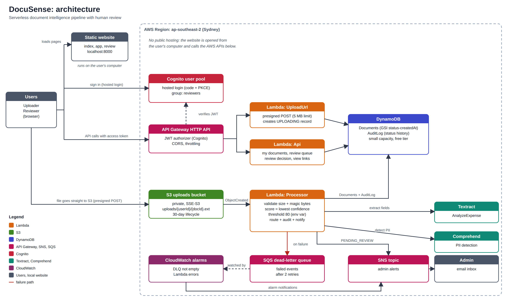
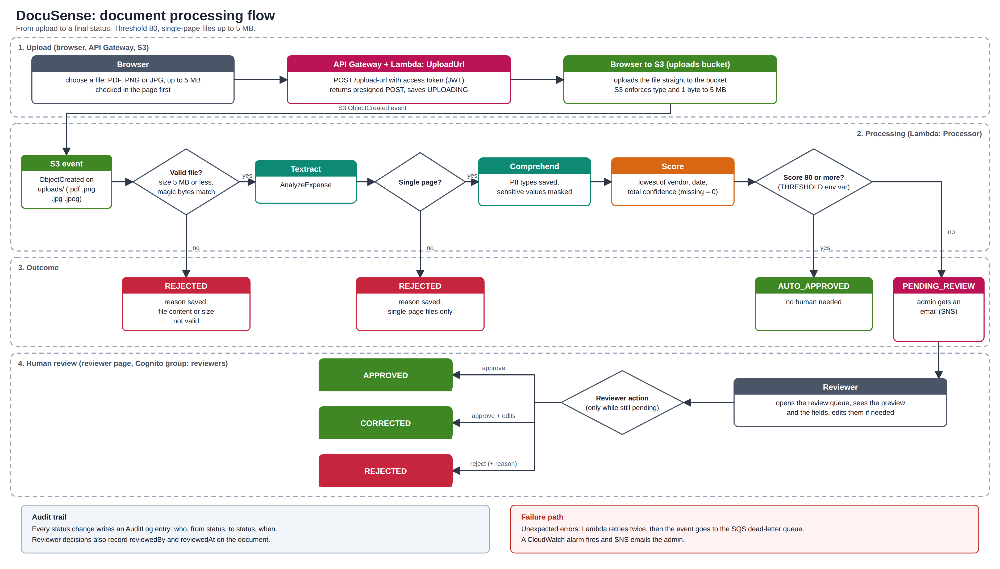

# DocuSense

**Serverless document intelligence pipeline with human review.**

Upload an invoice and DocuSense reads it automatically: it extracts the vendor, date and total with a confidence score for each, spots personal data and masks the sensitive parts, and decides whether the result can be trusted. Documents the system is sure about are approved on their own. Everything else is sent to a human reviewer, who can approve, correct or reject it. Every status change is recorded in an audit trail.

It is built entirely from AWS managed services (no servers to run), in the **Asia Pacific (Sydney) ap-southeast-2** region, and is sized to stay inside the AWS Free Tier. Only synthetic sample documents are used.

<!-- The demo video link is added here in Task D10-5. -->

## Contents

1. [What it does](#what-it-does)
2. [Architecture](#architecture)
3. [How a document flows](#how-a-document-flows)
4. [API](#api)
5. [Data model](#data-model)
6. [Security](#security)
7. [Well-Architected mapping](#well-architected-mapping)
8. [Cost](#cost)
9. [Testing](#testing)
10. [Setup](#setup)
11. [Repository layout](#repository-layout)
12. [Limitations and future work](#limitations-and-future-work)
13. [Teardown](#teardown)

## What it does

| Who | What they can do |
|---|---|
| **Uploader** | Sign in, upload a single-page PDF, PNG or JPG (up to 5 MB), and watch its status change in a table. |
| **Reviewer** (Cognito group `reviewers`) | See every document waiting for review, preview the file next to the extracted fields, then approve it, correct the fields, or reject it with a reason. |
| **Admin** | Gets an email when a document needs review and when something fails. |

Highlights:

- **Confidence-based routing.** The score is the *lowest* of the vendor, date and total confidences (a missing field counts as 0). A score of 80 or more is approved automatically. Anything lower goes to a person.
- **Safe uploads.** The browser sends the file straight to S3 with a short-lived presigned form that fixes the file type and a size limit of 5 MB. The file never passes through the API.
- **Defence in depth.** The processor checks the real file type from its first bytes, not just its extension, and rejects fake or multi-page files with a clear reason.
- **Privacy.** Comprehend detects personal data. Only the *types* found are stored, and sensitive values such as bank account numbers are stored masked (last four characters only).
- **Human in the loop.** Review decisions are conditional, so a document that is no longer pending cannot be decided twice, and each decision records who made it and when.
- **Failure handling.** Failed events are retried twice, then parked in a dead-letter queue, and CloudWatch alarms email the admin.

## Architecture



The website is a few static files (plain HTML, CSS and JavaScript, no frameworks). It runs from the user's computer and talks to AWS through Cognito and an HTTP API.

| Service | Role in DocuSense |
|---|---|
| **Amazon Cognito** | User pool with email sign-in, hosted login using the authorization code flow with PKCE, and the `reviewers` group. |
| **Amazon API Gateway (HTTP API)** | Five routes protected by a JWT authorizer that checks Cognito tokens before any code runs. |
| **AWS Lambda** (Python 3.12) | `DocuSense-UploadUrl` (presigned upload), `DocuSense-Api` (documents and review) and `DocuSense-Processor` (the pipeline). |
| **Amazon S3** | Private uploads bucket with encryption, a 30-day lifecycle rule and an event trigger. |
| **Amazon Textract** | `AnalyzeExpense` reads the invoice fields and their confidence. |
| **Amazon Comprehend** | `DetectPiiEntities` finds personal data in the extracted text. |
| **Amazon DynamoDB** | `Documents` table (with a status index for the review queue) and an `AuditLog` table. |
| **Amazon SNS** | Emails the admin when a document needs review and when an alarm fires. |
| **Amazon SQS** | Dead-letter queue for events the processor could not handle. |
| **Amazon CloudWatch** | Logs (kept 7 days) and two alarms: dead-letter queue not empty, and processor errors. |
| **AWS IAM** | One least-privilege role per Lambda. |
| **AWS Budgets** | A $1 monthly budget with an email alert at 80%. |

## How a document flows



1. The page checks the file (type, 5 MB limit) and asks `POST /upload-url` for a presigned form. The Lambda saves an `UPLOADING` record that includes the file name.
2. The browser uploads the file straight to `uploads/{userId}/{docId}.{ext}` in S3.
3. S3 notifies the **processor** (only for the prefix `uploads/` and the extensions `.pdf`, `.png`, `.jpg`, `.jpeg`).
4. The processor validates the file: not empty, 5 MB or less, and the first bytes match the extension. Otherwise the document becomes `REJECTED` with the reason.
5. It calls Textract. A multi-page PDF is rejected as `REJECTED` ("single-page files only").
6. It sends the text to Comprehend and stores the PII types and masked sensitive values.
7. It scores the document and routes it:

| Status | Meaning |
|---|---|
| `UPLOADING` | The upload slot was created and the file has not been processed yet. |
| `AUTO_APPROVED` | Score of 80 or more. No human needed. |
| `PENDING_REVIEW` | Score below 80. The admin is emailed and the document appears in the review queue. |
| `APPROVED` | A reviewer confirmed the extracted values unchanged. |
| `CORRECTED` | A reviewer fixed one or more fields (they are marked as corrected). |
| `REJECTED` | Invalid file, multi-page file, or rejected by a reviewer (the reason is stored). |

Every change writes an entry to the `AuditLog` table (who, from status, to status, when). Writes from the processor are conditional, so re-delivered events never overwrite a final result or send a second email.

## API

All routes require a valid Cognito access token. The caller's identity always comes from the token, never from the request.

| Route | Who | What it does |
|---|---|---|
| `POST /upload-url` | Any signed-in user | Returns a presigned POST (type and size enforced by S3) and creates the `UPLOADING` record. |
| `GET /documents` | Any signed-in user | Lists the caller's own documents, newest first. |
| `GET /documents/{id}` | Any signed-in user | One of the caller's documents with a 5-minute view link. Another user's document returns 404. |
| `GET /review/pending` | `reviewers` only | The review queue, read from the status index. Others get 403. |
| `POST /review/{id}` | `reviewers` only | Body `{"action": "approve" \| "correct" \| "reject"}` with `fields` for corrections or an optional `reason`. Only works while the status is `PENDING_REVIEW`. |

## Data model

**`Documents`**: partition key `userId` (the Cognito `sub`), sort key `docId`. Global secondary index `status-createdAt` (partition key `status`, sort key `createdAt`) serves the review queue without scanning the table.

Main attributes: `status`, `filename`, `contentType`, `s3Key`, `createdAt`, `updatedAt`, `fields` (value and confidence for vendor, date and total), `score`, `piiTypes`, `piiMasked`, `reason`, `reviewedBy`, `reviewedAt`.

**`AuditLog`**: partition key `docId`, sort key `timestamp`. Attributes: `fromStatus`, `toStatus`, `actor` (`system` or the reviewer's id), `action`, `reason`.

## Security

- **No public buckets.** Block Public Access is on, ACLs are disabled, objects are encrypted (SSE-S3), and uploads expire after 30 days.
- **Authentication and authorization.** Cognito sign-in, a JWT authorizer on every route, and a group check for the review routes. The website only hides the review link for convenience. The API is what enforces access.
- **Data isolation.** Every query is keyed by the caller's `sub`. Tests confirm that one user cannot read another user's document.
- **Least-privilege IAM.** Each Lambda has its own role limited to the exact buckets, tables, topic and queue it uses. The only wildcard resources are Textract and Comprehend, which do not support resource-level permissions.
- **Safe uploads.** Presigned POST with enforced content type and 1 byte to 5 MB, and a magic-byte check on the server side.
- **Privacy by design.** Raw sensitive values are never stored or logged. Logs contain PII types only.
- **Browser safety.** Pages write data with `textContent` (no HTML injection), the sign-in flow checks the OAuth `state` value, and the refresh token is never stored.
- **No secrets in code.** Settings are environment variables holding only names and a number. The values in the website files (Cognito domain, public client ID, API address) are public by design.

## Well-Architected mapping

| Pillar | How DocuSense addresses it |
|---|---|
| **Operational excellence** | CloudWatch logs with 7-day retention, alarms for the dead-letter queue and processor errors, an audit trail table, a 12-case test matrix, and written teardown steps. |
| **Security** | Private encrypted buckets, JWT-protected API, group-based review access, least-privilege roles, PII masking, validated uploads, and no stored secrets. |
| **Reliability** | Two automatic retries then a dead-letter queue, idempotent conditional writes, fully managed services, and alarms that email the admin. |
| **Performance efficiency** | Files go straight to S3 (not through Lambda or the API), the review queue uses an index instead of scans, and the pipeline scales with the number of uploads. |
| **Cost optimization** | Pay-per-use serverless design, capacity sized to the Free Tier, a 5 MB single-page limit that caps Textract cost, short log and file retention, and a $1 budget alert. |
| **Sustainability** | No idle servers, small right-sized functions (256 MB), and files deleted automatically after 30 days. |

## Cost

DocuSense is designed to cost about **$0** at demo scale.

| Item | Why it stays small |
|---|---|
| Lambda, API Gateway, SNS, SQS, CloudWatch, Cognito, S3 | Usage is a few requests, far below the Free Tier limits. |
| DynamoDB | Provisioned capacity of 5 read and 5 write units for each of the three tables and indexes (15 of the 25 free units). |
| Textract and Comprehend | The only per-use charges. Each upload costs one Textract page and a few hundred characters of Comprehend, so a handful of test uploads is a fraction of a cent. The single-page and 5 MB limits cap the cost per upload. |
| Logs and files | Log groups keep 7 days and uploaded files expire after 30 days. |

Guardrails: a $1 monthly AWS Budget with an email alert at 80%, Free Tier usage checked in Billing, and a teardown guide below. Check current AWS pricing before using it with real volumes.

## Testing

A 12-case matrix was run end to end, and every case behaved as designed:

| Case | Result |
|---|---|
| Clean invoice | `AUTO_APPROVED` |
| Blurry invoice | `PENDING_REVIEW`, admin emailed |
| Text file renamed to `.pdf` | `REJECTED` (content does not match its extension) |
| Two-page PDF | `REJECTED` (single-page files only) |
| File over 5 MB (browser) | Blocked in the page |
| Wrong file type (browser) | Blocked in the page |
| Wrong file type sent straight to the API | `400` |
| Oversized file sent straight to S3 | `400 EntityTooLarge` (enforced by S3, not only by the page) |
| A second user uploads their own file | Processed normally |
| Each user lists documents | Only their own |
| Another user's document / review route as a non-reviewer | `404` / `403` |
| Direct S3 object address | Access Denied (bucket is private) |

Route-level tests with real tokens covered 12 route and user combinations (`401`, `403`, `404`, `400`, `200`), and the reviewer decisions were checked in the `Documents` and `AuditLog` tables.

## Setup

DocuSense was built by hand in the AWS Console. To reproduce it you need an AWS account, **Python 3.12** (for the local web server), Git, and the files in this repository. Use an IAM user with MFA, not the root user, and keep everything in `ap-southeast-2`.

1. **Storage.** Create the S3 bucket `docusense-uploads-<your-name>` (Block Public Access on, SSE-S3, a lifecycle rule that expires `uploads/` after 30 days, and CORS allowing `POST` from `http://localhost:8000`). Create the DynamoDB tables `Documents` (partition key `userId`, sort key `docId`, plus the index `status-createdAt` with partition key `status` and sort key `createdAt`) and `AuditLog` (partition key `docId`, sort key `timestamp`).
2. **Processor.** Create `DocuSense-Processor` (Python 3.12, 256 MB, 60 s) from `backend/processor/lambda_function.py`, with its own least-privilege role. Add an S3 trigger on the bucket for the prefix `uploads/` and each of the suffixes `.pdf`, `.png`, `.jpg` and `.jpeg`.
3. **Notifications and failure handling.** Create an SNS topic with a confirmed email subscription and an SQS queue for failures. Set the processor's asynchronous invocation to 2 retries with the queue as the on-failure destination. Create CloudWatch alarms for the queue (messages visible) and the processor (errors), both notifying the topic, and set log retention to 7 days.
4. **Sign-in.** Create a Cognito user pool (email sign-in, email verification) with a public app client (no secret, authorization code grant, scopes `openid` and `email`), a hosted login domain, the callback and sign-out URL `http://localhost:8000/`, and a group named `reviewers`. Create one uploader and one reviewer, and add the reviewer to the group.
5. **API.** Create `DocuSense-UploadUrl` (from `backend/upload_url/`) and `DocuSense-Api` (from `backend/api/`), each with its own role. Create an HTTP API with a JWT authorizer (issuer `https://cognito-idp.ap-southeast-2.amazonaws.com/<user-pool-id>`, audience = the app client ID), attach it to the five routes above, and set CORS to allow the origin `http://localhost:8000`, the headers `authorization` and `content-type`, and the methods `GET`, `POST` and `OPTIONS`.
6. **Website.** Put your own values into the top of `frontend/auth.js` (`cognitoDomain`, `clientId`) and `frontend/api.js` (`API_BASE`). In the `frontend/` folder run:

   ```
   python -m http.server 8000
   ```

   Then open `http://localhost:8000/` (use `localhost`, not `127.0.0.1`), sign in, and upload a file from `sample-docs/`.

Lambda environment variables (names and settings only, never secrets):

| Function | Variables |
|---|---|
| `DocuSense-Processor` | `TABLE_NAME` (Documents), `AUDIT_TABLE` (AuditLog), `SNS_TOPIC_ARN`, `THRESHOLD` (80) |
| `DocuSense-UploadUrl` | `BUCKET_NAME`, `TABLE_NAME` |
| `DocuSense-Api` | `TABLE_NAME`, `AUDIT_TABLE`, `BUCKET_NAME` |

## Repository layout

| Folder | Contents |
|---|---|
| `frontend/` | The website: `index.html`, `app.html`, `review.html`, `style.css`, `auth.js`, `api.js`, `review.js`. |
| `backend/` | Source of the three Lambda functions (`processor`, `upload_url`, `api`). |
| `sample-docs/` | Synthetic test files: clean, blurry, fake, multi-page and PII invoices. |
| `docs/` | Architecture and flow diagrams (PNG and SVG) and screenshots. |

## Limitations and future work

**Limitations**

- **Single page, invoices only.** The synchronous `AnalyzeExpense` call handles single-page documents. Other document types are out of scope.
- **Not publicly hosted.** The website runs from `localhost:8000`. Public hosting with S3 and CloudFront was dropped because CloudFront needed a higher account plan, and Cognito only accepts plain HTTP callbacks for localhost.
- **Built by hand.** There is no infrastructure as code, so the setup steps above are manual.
- **No API throttling is configured.** Stage-level rate limits were not set in this build.
- **Orphan upload records.** If an upload is requested but the file never arrives (for example, the oversize file sent straight to S3 in the test), the `UPLOADING` record stays behind.
- **Manual refresh.** The status table updates when the user presses Refresh (and after each upload).
- **Fixed settings.** The threshold of 80 is the same for every vendor, lists show at most 50 to 100 items without pagination, and preview links last 5 minutes.
- **Open sign-up.** Cognito self-registration is enabled, so anyone can create an uploader account.
- **No automated tests or CI.** Testing was done by hand against the live account.
- **Single region.** No cross-region backup or failover.

**Future work**

- Host the site on S3 behind CloudFront with Origin Access Control, security headers and a custom domain.
- Describe the whole stack in infrastructure as code (SAM, CDK or Terraform) and deploy it from CI.
- Add API throttling, an AWS WAF web ACL, and invite-only sign-up.
- Support multi-page PDFs with asynchronous Textract, and other document types.
- Clean up abandoned `UPLOADING` records automatically (a DynamoDB TTL or a scheduled cleanup).
- Push status changes to the page instead of polling, and add pagination.
- Learn from reviewer corrections (for example, per-vendor thresholds).
- Add automated unit and integration tests.

## Teardown

Everything in this project runs in one AWS region, **ap-southeast-2 (Sydney)**, and was built by hand in the AWS Console. Nothing here is needed for normal use. Follow this section only when you want to remove the whole project and stop all possible charges.

**Before you start**

- Finish the demo video and all screenshots first. Once the resources are deleted you cannot capture them again.
- Make sure the Console is set to **Asia Pacific (Sydney)**. IAM is global, so it does not depend on the region.
- Work in the order below. Dependencies are deleted first, so nothing complains about something still being in use.

| # | Service | Delete this | Notes |
|---|---|---|---|
| 1 | CloudWatch → Alarms | `DocuSense-DLQ-Messages`, `DocuSense-Processor-Errors` | Delete the alarms first so they cannot send emails while things disappear. |
| 2 | S3 | `docusense-uploads-ap-southeast-2` | Open the bucket, choose **Empty**, confirm, then choose **Delete**. This also removes the upload trigger, the CORS rule and the 30-day lifecycle rule. |
| 3 | Lambda | `DocuSense-Processor`, `DocuSense-UploadUrl`, `DocuSense-Api` | Choose **Actions → Delete function** for each. |
| 4 | API Gateway | `DocuSense-API` | Deleting the API also removes its routes, the JWT authorizer and the stage. |
| 5 | Cognito | User pool `DocuSense-UserPool` | If **Deletion protection** is on, turn it off in the pool's settings first. Deleting the pool removes its users, the `reviewers` group, the app client and the hosted login domain. |
| 6 | DynamoDB | Tables `Documents` and `AuditLog` | Untick **Create a backup** when asked, so no backup is left behind. Deleting `Documents` also removes the `status-createdAt` index. |
| 7 | SNS and SQS | SNS topic `DocuSense-AdminAlerts`, SQS queue `DocuSense-ProcessorDLQ` | Deleting the topic also removes its email subscription. |
| 8 | CloudWatch → Log groups | `/aws/lambda/DocuSense-Processor`, `/aws/lambda/DocuSense-UploadUrl`, `/aws/lambda/DocuSense-Api` | Lambda leaves these behind when a function is deleted. |
| 9 | IAM → Roles | `DocuSense-ProcessorRole`, `DocuSense-UploadUrlRole`, `DocuSense-ApiRole` | Do this after the Lambda functions are gone. The inline policies are removed with each role. |
| 10 | Leftovers, if they still exist | The unused website bucket `docusense-web-<account-id>-ap-southeast-2` and the CloudFront response headers policy `DocuSense-SecurityHeaders` | These belong to the dropped CloudFront plan. Empty the bucket before deleting it. |

**Optional clean-up**

- **Budget:** keep the $1 monthly budget as a safety net, or delete it in AWS Budgets if you want a completely clean account.
- **CLI access:** if you no longer need the command line, delete the IAM user's access keys (IAM → Users → Security credentials) and remove the local `aws configure` credentials.
- **Local files:** nothing on your computer needs deleting. The `frontend/` folder only talks to the AWS resources above, so it simply stops working once they are gone.

**Check that everything is gone**

1. In each service above, search for `DocuSense` while in the Sydney region. Nothing should be listed.
2. The next day, open **Billing and Cost Management → Bills** and **Free Tier**. They should show no running DocuSense usage, and the month-to-date spend should stay at about $0.

The AWS Free plan account has its own expiry date, which is separate from these resources. Deleting the resources above stops their charges regardless of that date.
